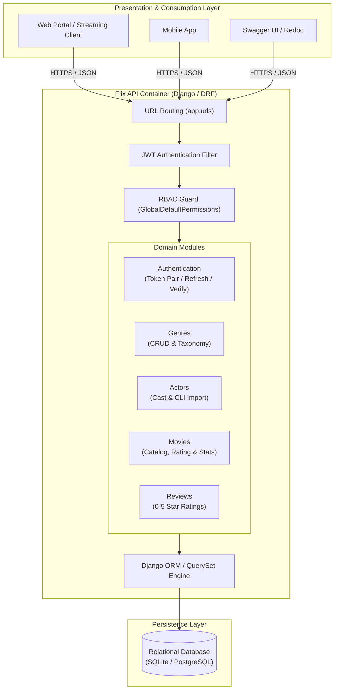
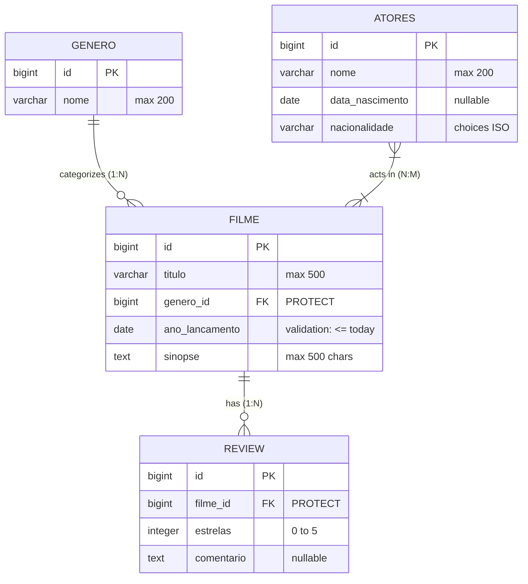
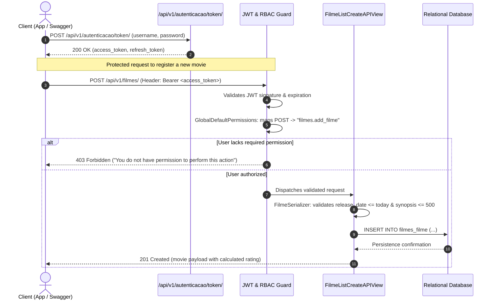

# 🎬 Flix API — RESTful Audiovisual Catalog & Reviews Platform

[🇧🇷 Português](README.md) | [🇺🇸 English](README.en.md)

---

## 📌 Product Overview

**Flix API** is a robust RESTful backend solution designed to power streaming platforms, cinema curation portals, and entertainment applications. The product centralizes the management of audiovisual titles, cast (actors), genre taxonomy, and community engagement through user ratings and reviews.

### Core Product Capabilities:
- **Movie Catalog Management**: Complete registry of titles with synopses, multidimensional cast, release dates, and genres.
- **Engagement & Review System**: 0 to 5-star rating system with user feedback and automated dynamic score computation (`rating`) per title.
- **Real-Time Analytics Dashboard (`/stats/`)**: Aggregated metrics providing total production count, review tally, quantitative distribution per genre, and overall community satisfaction score.
- **Cast Curation with Batch Import**: Actor registration with standardized ISO nationalities and a dedicated CLI tool for massive CSV data ingestion.

---

## 🏗️ Software Architecture & Engineering Highlights

Built with **Django 5.2** and **Django REST Framework (DRF) 3.16**, applying modern separation of concerns, multi-layered security, and high-performance relational query optimization:

```
┌────────────────────────────────────────────────────────────────────────┐
│                               Flix API                                 │
├───────────────┬────────────────────────────┬───────────────────────────┤
│   Stateless   │ Declarative Dynamic (RBAC) │  Optimized ORM Queries    │
│  JWT Security │ Access Control Guard       │  & Aggregations           │
│  SimpleJWT    │ GlobalDefaultPermissions   │  Count(), Avg(), Annotate │
└───────────────┴────────────────────────────┴───────────────────────────┘
```

### 1. Declarative Dynamic Role-Based Access Control (RBAC)
Instead of hardcoded rules or scattered manual checks across views, authorization security is centralized by the [`GlobalDefaultPermissions`](app/permissions.py) class:
- Dynamically maps the incoming HTTP method (`GET`, `POST`, `PUT`, `PATCH`, `DELETE`) to the native Django Auth codename (`view`, `add`, `change`, `delete`).
- Evaluates whether the authenticated user possesses `<app_label>.<model_name>_<action>`.
- Enables system administrators to configure roles, groups, and permissions directly via Django Admin without altering any backend API code.

### 2. Stateless JWT Authentication
Implemented via `djangorestframework-simplejwt`, ensuring total server state decoupling:
- **Access Token**: 1-day TTL for authenticated operations.
- **Refresh Token**: 7-day TTL for secure credential rotation.
- Native `Authorization: Bearer <token>` support across all endpoints and in the interactive Swagger UI.

### 3. ORM Aggregations & Query Optimization
- **Dynamic Rating Computation**: The `rating` field returned for each movie is computed dynamically via `SerializerMethodField`, aggregating average stars across related reviews via reverse relation (`obj.reviews.aggregate(Avg('estrelas'))`).
- **Analytics Endpoint `/api/v1/filmes/stats/`**: Executes weighted aggregation in a single query with `values('genero').annotate(total=Count('id')).order_by('-total')`.

### 4. Strict Domain Validations
- **Temporal Integrity**: The custom `validate_ano_lancamento` validator rejects future release dates.
- **Payload & Content Control**: The `validate_sinopse` validator enforces a 500-character ceiling.
- **Score Range Constraint**: Reviews utilize `MinValueValidator(0)` and `MaxValueValidator(5)`.
- **Referential Integrity**: Foreign keys employ `on_delete=models.PROTECT`, preventing accidental cascading deletions of genres or actors linked to active movies.

---

## 📐 Architectural Diagrams

### 1. C4 Container Diagram



---

### 2. Entity-Relationship Diagram (ERD)



---

### 3. Sequence Diagram: Authentication & RBAC Authorization



---

## 📡 RESTful Endpoints Reference

All endpoints are versioned under `/api/v1/`.

| Method | Endpoint | Required Permission | Description |
|:---|:---|:---|:---|
| `POST` | `/api/v1/autenticacao/token/` | Public | Issues JWT pair (`access` and `refresh`). |
| `POST` | `/api/v1/autenticacao/token/refresh/` | Public | Refreshes `access` token using valid `refresh`. |
| `POST` | `/api/v1/autenticacao/token/verify/` | Public | Validates signature and expiration of a token. |
| `GET` | `/api/v1/generos/` | `generos.view_genero` | Lists all registered movie genres. |
| `POST` | `/api/v1/generos/` | `generos.add_genero` | Creates a new genre. |
| `GET` | `/api/v1/generos/{id}/` | `generos.view_genero` | Retrieves genre details by ID. |
| `PUT` | `/api/v1/generos/{id}/` | `generos.change_genero` | Updates a genre. |
| `DELETE` | `/api/v1/generos/{id}/` | `generos.delete_genero` | Deletes a genre (protected against active FK). |
| `GET` | `/api/v1/atores/` | `atores.view_atores` | Lists all actors (sorted by name). |
| `POST` | `/api/v1/atores/` | `atores.add_atores` | Adds a new actor to the catalog. |
| `GET` | `/api/v1/atores/{id}/` | `atores.view_atores` | Retrieves actor details by ID. |
| `PUT` | `/api/v1/atores/{id}/` | `atores.change_atores` | Updates actor information. |
| `DELETE` | `/api/v1/atores/{id}/` | `atores.delete_atores` | Removes an actor. |
| `GET` | `/api/v1/filmes/` | `filmes.view_filme` | Lists movies with dynamically computed rating. |
| `POST` | `/api/v1/filmes/` | `filmes.add_filme` | Creates a movie with genre and cast relations. |
| `GET` | `/api/v1/filmes/{id}/` | `filmes.view_filme` | Retrieves a movie by ID. |
| `PUT` | `/api/v1/filmes/{id}/` | `filmes.change_filme` | Updates a movie. |
| `DELETE` | `/api/v1/filmes/{id}/` | `filmes.delete_filme` | Deletes a movie. |
| `GET` | `/api/v1/filmes/stats/` | `filmes.view_filme` | Returns real-time catalog analytics. |
| `GET` | `/api/v1/reviews/` | `reviews.view_review` | Lists all reviews. |
| `POST` | `/api/v1/reviews/` | `reviews.add_review` | Submits a new review (0-5 stars + optional comment). |
| `GET` | `/api/v1/reviews/{id}/` | `reviews.view_review` | Retrieves review by ID. |
| `PUT` | `/api/v1/reviews/{id}/` | `reviews.change_review` | Updates a review. |
| `DELETE` | `/api/v1/reviews/{id}/` | `reviews.delete_review` | Deletes a review. |

---

### Request & Response Payload Examples

#### 1. Authentication & Token Acquisition
`POST /api/v1/autenticacao/token/`
```json
// Request Body
{
  "username": "admin",
  "password": "secure_password"
}

// Response (200 OK)
{
  "refresh": "eyJhbGciOiJIUzI1NiIsInR5cCI6IkpXVCJ9...",
  "access": "eyJhbGciOiJIUzI1NiIsInR5cCI6IkpXVCJ9..."
}
```

#### 2. Register Movie with Cast & Domain Validations
`POST /api/v1/filmes/`  
*Header:* `Authorization: Bearer <access_token>`
```json
// Request Body
{
  "titulo": "Interstellar",
  "genero": 1,
  "ano_lancamento": "2014-11-07",
  "atores": [1, 4, 7],
  "sinopse": "A team of explorers travel through a wormhole in space in an attempt to ensure humanity's survival."
}

// Response (201 Created)
{
  "id": 1,
  "rating": null,
  "titulo": "Interstellar",
  "ano_lancamento": "2014-11-07",
  "sinopse": "A team of explorers travel through a wormhole in space in an attempt to ensure humanity's survival.",
  "genero": 1,
  "atores": [1, 4, 7]
}
```

#### 3. Submit Movie Review
`POST /api/v1/reviews/`  
*Header:* `Authorization: Bearer <access_token>`
```json
// Request Body
{
  "filme": 1,
  "estrelas": 5,
  "comentario": "Masterpiece of modern science fiction."
}

// Response (201 Created)
{
  "id": 1,
  "filme": 1,
  "estrelas": 5,
  "comentario": "Masterpiece of modern science fiction."
}
```

#### 4. Real-time Analytics Statistics Query
`GET /api/v1/filmes/stats/`  
*Header:* `Authorization: Bearer <access_token>`
```json
// Response (200 OK)
{
  "total_filmes": 42,
  "filmes_por_genero": [
    { "genero": 1, "total": 15 },
    { "genero": 2, "total": 12 },
    { "genero": 3, "total": 8 }
  ],
  "total_reviews": 128,
  "media_avaliacoes": 4.6
}
```

---

## 📖 Interactive Documentation (Swagger & Redoc)

The API ships with built-in interactive OpenAPI 2.0 / Swagger interfaces:

- **Swagger UI**: `http://localhost:8000/swagger/`
- **Redoc**: `http://localhost:8000/redoc/`

### How to Authenticate in Swagger UI:
1. Issue credentials to `/api/v1/autenticacao/token/`.
2. Copy the `"access"` token string.
3. Click the **Authorize** lock button at the top right of the Swagger UI page.
4. In the **Value** input field, type `Bearer <your_access_token>` (ensure a space after `Bearer `).
5. Click **Authorize** and close the modal. All subsequent test requests will automatically include the authorization header.

---

## ⚡ CLI Batch Ingestion: Import Actors

The repository provides a dedicated Django management command (`atores/management/commands/import_atores.py`) to seed actors from structured CSV files:

```bash
# Local Execution
python manage.py import_atores Lista_atores.csv

# Docker Compose Execution
docker compose exec flix-api python manage.py import_atores Lista_atores.csv
```

### Command Highlights:
- Resilient date parsing with automated fallback logging upon malformed values.
- Automatic nationality string mapping to official ISO code choices (`CONST_NACIONALIDADE`).
- Real-time colored terminal feedback reporting warnings, processed records, and total elapsed success.

---

## 🚀 Getting Started

### Prerequisites
- **Docker** and **Docker Compose** (recommended) OR **Python 3.12+**.

---

### Option 1: Running with Docker Compose (Recommended)

1. **Build and start services in the background:**
   ```bash
   docker compose up --build -d
   ```

2. **Run database migrations:**
   ```bash
   docker compose exec flix-api python manage.py migrate
   ```

3. **Create the administrative superuser:**
   ```bash
   docker compose exec flix-api python manage.py createsuperuser
   ```

4. **(Optional) Seed initial actors dataset:**
   ```bash
   docker compose exec flix-api python manage.py import_atores Lista_atores.csv
   ```

5. **Access the application:**
   - Swagger UI: `http://localhost:8000/swagger/`
   - Admin Panel: `http://localhost:8000/admin/`
   - API Base: `http://localhost:8000/api/v1/`

---

### Option 2: Running Locally with Python Virtual Environment

1. **Create and activate virtual environment:**
   ```bash
   # Windows
   python -m venv venv
   .\venv\Scripts\activate

   # Linux / macOS
   python3 -m venv venv
   source venv/bin/activate
   ```

2. **Install project dependencies:**
   ```bash
   pip install -r requirements.txt
   ```

3. **Apply database schema migrations:**
   ```bash
   python manage.py migrate
   ```

4. **Create admin user:**
   ```bash
   python manage.py createsuperuser
   ```

5. **(Optional) Ingest actor list:**
   ```bash
   python manage.py import_atores Lista_atores.csv
   ```

6. **Launch the development server:**
   ```bash
   python manage.py runserver 0.0.0.0:8000
   ```

---

## 📂 Project Structure

```
flix_api/
├── app/                  # Django project root configuration
│   ├── permissions.py    # Declarative RBAC (GlobalDefaultPermissions)
│   ├── settings.py       # Settings, JWT lifetimes & Swagger setup
│   ├── urls.py           # Central routing and OpenAPI schema endpoints
│   ├── wsgi.py           # WSGI interface
│   └── asgi.py           # ASGI interface
├── autenticacao/         # JWT issuance and token validation app
├── generos/              # Movie genres and taxonomy app
├── atores/               # Cast and actor profiles app
│   └── management/
│       └── commands/
│           └── import_atores.py # Custom CSV batch ingestion CLI
├── filmes/               # Movies catalog, dynamic ratings & analytics app
├── reviews/              # User evaluations and rating reviews app
├── Lista_atores.csv      # Structured dataset for actor seeding
├── Dockerfile            # Optimized multi-stage build (Python 3.12-slim)
├── docker-compose.yml    # Container orchestration and volume binding
├── requirements.txt      # Production dependencies
└── manage.py             # Django management CLI entrypoint
```

---

## 🔒 Security & Best Practices

- **Granular Method Permissions**: No mutating endpoint (`POST`, `PUT`, `DELETE`) allows anonymous access.
- **Fail-Fast Validation**: Domain constraints validated at the serializer level before database interaction.
- **Lightweight Containers**: Multi-stage `Dockerfile` ensuring minimal attack surface and small image footprint.
- **Environment Decoupling**: Ready for 12-factor configuration in staging/production environments.

---

## 📄 License

This project is developed for technical demonstration, software architecture evaluation, and backend engineering portfolio presentation.

