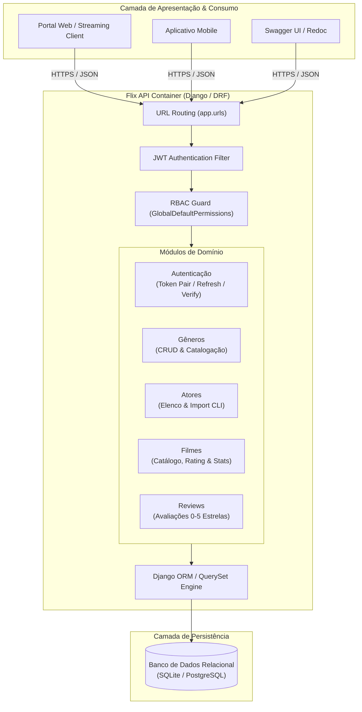
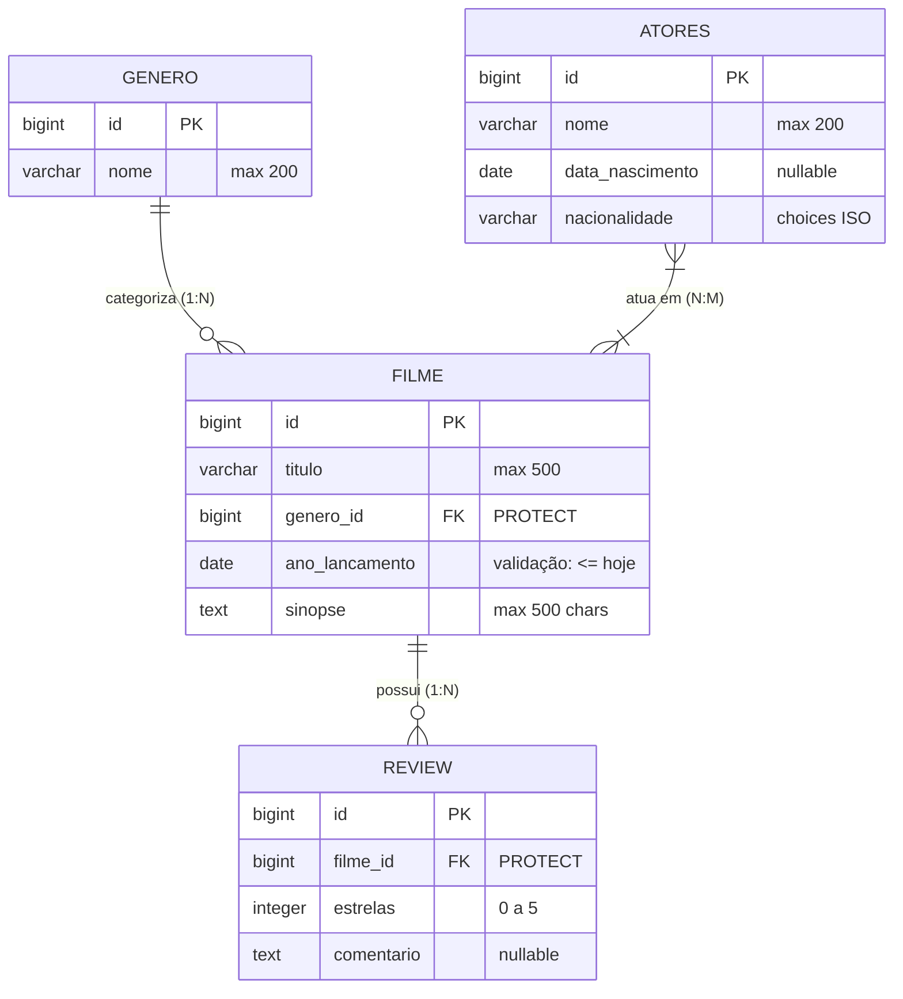
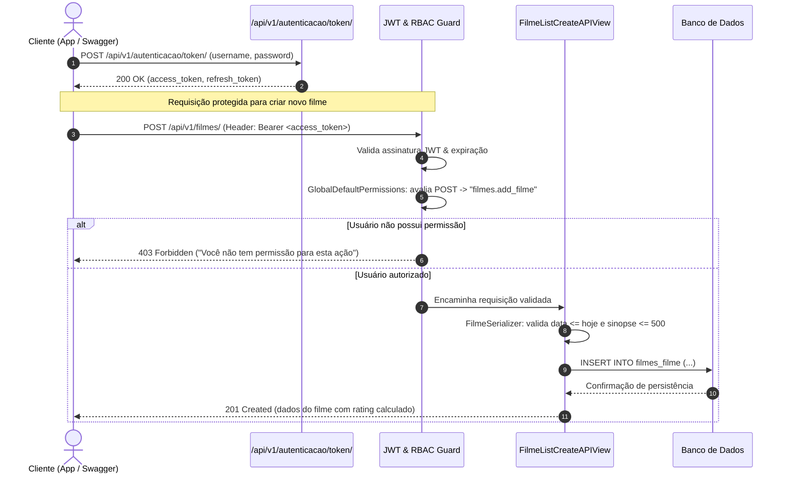

# 🎬 Flix API — Plataforma RESTful de Catálogo Audiovisual & Avaliações

[🇧🇷 Português](README.md) | [🇺🇸 English](README.en.md)

---

## 📌 Visão Geral do Produto

A **Flix API** é uma solução de backend RESTful projetada para alimentar plataformas de streaming, portais de curadoria cinematográfica e aplicativos de entretenimento. O produto centraliza a gestão de títulos audiovisuais, elenco (atores), categorização taxonômica (gêneros) e o engajamento da comunidade por meio de avaliações e críticas de usuários.

### Principais Capacidades do Produto:
- **Gestão de Catálogo de Filmes**: Cadastro completo de títulos com sinopse, elenco multidimensional, data de lançamento e gênero.
- **Sistema de Engajamento e Críticas**: Avaliação de 0 a 5 estrelas com comentários de audiência e cálculo automático da pontuação média (`rating`) de cada obra.
- **Painel Analítico de Catálogo (`/stats/`)**: Métricas agregadas em tempo real com total de produções, contagem de avaliações, distribuição quantitativa por gênero e média geral de satisfação da audiência.
- **Curadoria de Elenco com Carga em Lote**: Cadastro de atores com nacionalidades padronizadas (norma ISO) e ferramenta CLI para ingestão massiva de dados via CSV.

---

## 🏗️ Arquitetura de Software & Destaques de Engenharia

O projeto foi construído sobre o ecossistema **Django 5.2** e **Django REST Framework (DRF) 3.16**, empregando práticas modernas de separação de responsabilidades, segurança em camadas e alto desempenho em consultas relacionais:

```
┌────────────────────────────────────────────────────────────────────────┐
│                               Flix API                                 │
├───────────────┬────────────────────────────┬───────────────────────────┤
│  Autenticação │ Controle de Acesso (RBAC)  │  Consultas & Agregações   │
│  Stateless    │ Dinâmico Declarativo       │  Otimizadas no ORM        │
│  JWT Tokens   │ GlobalDefaultPermissions   │  Count(), Avg(), Annotate │
└───────────────┴────────────────────────────┴───────────────────────────┘
```

### 1. Controle de Acesso Dinâmico Baseado em Papéis (RBAC Declarativo)
Em vez de regras estáticas ou verificações manuais espalhadas pelas views, a segurança de autorização é orquestrada pela classe [`GlobalDefaultPermissions`](app/permissions.py):
- Mapeia o método HTTP da requisição (`GET`, `POST`, `PUT`, `PATCH`, `DELETE`) para o codename nativo do Django Auth (`view`, `add`, `change`, `delete`).
- Avalia dinamicamente se o usuário logado possui a permissão `<app_label>.<model_name>_<action>`.
- Permite que administradores gerenciem perfis de acesso, grupos e permissões diretamente no Django Admin sem alterar uma única linha de código da API.

### 2. Autenticação Stateless com JWT (JSON Web Token)
Implementada com `djangorestframework-simplejwt`, garantindo desacoplamento total de estado no servidor:
- **Access Token**: Validade de 1 dia para operações autenticadas.
- **Refresh Token**: Validade de 7 dias para rotação e renovação segura de credenciais.
- Suporte nativo ao esquema `Authorization: Bearer <token>` em todos os endpoints e na interface interativa Swagger.

### 3. Agregações e Otimizações no ORM
- **Cálculo de Rating Dinâmico**: O campo `rating` retornado em cada filme é computado dinamicamente via `SerializerMethodField`, agregando a média de estrelas de todas as avaliações vinculadas através da relação reversa (`obj.reviews.aggregate(Avg('estrelas'))`).
- **Endpoint Analítico `/api/v1/filmes/stats/`**: Executa agregação ponderada em uma única viagem ao banco de dados com `values('genero').annotate(total=Count('id')).order_by('-total')`.

### 4. Validações Estritas de Regras de Negócio
- **Integridade Temporal**: O validador customizado `validate_ano_lancamento` rejeita lançamentos com datas futuras.
- **Controle de Conteúdo**: O validador `validate_sinopse` impõe teto de 500 caracteres, evitando sobrecarga no payload.
- **Restrição de Intervalo de Notas**: As avaliações de filmes utilizam validadores `MinValueValidator(0)` e `MaxValueValidator(5)`.
- **Integridade Referencial**: Relações de chave estrangeira utilizam `on_delete=models.PROTECT`, impedindo a remoção de gêneros ou atores associados a filmes ativos.

---

## 📐 Diagramas Arquiteturais

### 1. Diagrama de Arquitetura C4 (Nível de Contêineres)



---

### 2. Diagrama Entidade-Relacionamento (ERD)



---

### 3. Diagrama de Sequência: Autenticação & Autorização RBAC



---

## 📡 Catálogo Completo de Endpoints RESTful

A API é prefixada sob o versionamento `/api/v1/`.

| Método | Endpoint | Permissão Mínima Requerida | Descrição |
|:---|:---|:---|:---|
| `POST` | `/api/v1/autenticacao/token/` | Pública | Emite o par de tokens JWT (`access` e `refresh`). |
| `POST` | `/api/v1/autenticacao/token/refresh/` | Pública | Renova o `access` token a partir do `refresh`. |
| `POST` | `/api/v1/autenticacao/token/verify/` | Pública | Valida a autenticidade e expiração de um token. |
| `GET` | `/api/v1/generos/` | `generos.view_genero` | Lista todos os gêneros cadastrados. |
| `POST` | `/api/v1/generos/` | `generos.add_genero` | Cria um novo gênero cinematográfico. |
| `GET` | `/api/v1/generos/{id}/` | `generos.view_genero` | Detalha um gênero por ID. |
| `PUT` | `/api/v1/generos/{id}/` | `generos.change_genero` | Atualiza integralmente um gênero. |
| `DELETE` | `/api/v1/generos/{id}/` | `generos.delete_genero` | Exclui um gênero (protegido contra FK ativa). |
| `GET` | `/api/v1/atores/` | `atores.view_atores` | Lista todos os atores (ordenados por nome). |
| `POST` | `/api/v1/atores/` | `atores.add_atores` | Cadastra um novo ator no elenco. |
| `GET` | `/api/v1/atores/{id}/` | `atores.view_atores` | Detalha um ator por ID. |
| `PUT` | `/api/v1/atores/{id}/` | `atores.change_atores` | Atualiza os dados de um ator. |
| `DELETE` | `/api/v1/atores/{id}/` | `atores.delete_atores` | Exclui um ator. |
| `GET` | `/api/v1/filmes/` | `filmes.view_filme` | Lista os filmes cadastrados com rating calculado. |
| `POST` | `/api/v1/filmes/` | `filmes.add_filme` | Cadastra um novo filme com vínculo de gênero e atores. |
| `GET` | `/api/v1/filmes/{id}/` | `filmes.view_filme` | Detalha um filme específico com rating. |
| `PUT` | `/api/v1/filmes/{id}/` | `filmes.change_filme` | Atualiza os dados de um filme. |
| `DELETE` | `/api/v1/filmes/{id}/` | `filmes.delete_filme` | Exclui um filme. |
| `GET` | `/api/v1/filmes/stats/` | `filmes.view_filme` | Retorna métricas analíticas e estatísticas do catálogo. |
| `GET` | `/api/v1/reviews/` | `reviews.view_review` | Lista todas as avaliações de filmes. |
| `POST` | `/api/v1/reviews/` | `reviews.add_review` | Registra uma avaliação (nota de 0 a 5 com comentário). |
| `GET` | `/api/v1/reviews/{id}/` | `reviews.view_review` | Detalha uma avaliação por ID. |
| `PUT` | `/api/v1/reviews/{id}/` | `reviews.change_review` | Atualiza uma avaliação. |
| `DELETE` | `/api/v1/reviews/{id}/` | `reviews.delete_review` | Exclui uma avaliação. |

---

### Exemplos Práticos de Payloads

#### 1. Autenticação e Obtenção de Token
`POST /api/v1/autenticacao/token/`
```json
// Request Body
{
  "username": "admin",
  "password": "senha_segura"
}

// Response (200 OK)
{
  "refresh": "eyJhbGciOiJIUzI1NiIsInR5cCI6IkpXVCJ9...",
  "access": "eyJhbGciOiJIUzI1NiIsInR5cCI6IkpXVCJ9..."
}
```

#### 2. Cadastro de Filme com Elenco e Validação de Domínio
`POST /api/v1/filmes/`  
*Header:* `Authorization: Bearer <access_token>`
```json
// Request Body
{
  "titulo": "Interestelar",
  "genero": 1,
  "ano_lancamento": "2014-11-07",
  "atores": [1, 4, 7],
  "sinopse": "Uma equipe de exploradores viaja através de um buraco de minhoca no espaço para garantir a sobrevivência da humanidade."
}

// Response (201 Created)
{
  "id": 1,
  "rating": null,
  "titulo": "Interestelar",
  "ano_lancamento": "2014-11-07",
  "sinopse": "Uma equipe de exploradores viaja através de um buraco de minhoca no espaço para garantir a sobrevivência da humanidade.",
  "genero": 1,
  "atores": [1, 4, 7]
}
```

#### 3. Cadastro de Avaliação (Review)
`POST /api/v1/reviews/`  
*Header:* `Authorization: Bearer <access_token>`
```json
// Request Body
{
  "filme": 1,
  "estrelas": 5,
  "comentario": "Obra-prima da ficção científica moderna."
}

// Response (201 Created)
{
  "id": 1,
  "filme": 1,
  "estrelas": 5,
  "comentario": "Obra-prima da ficção científica moderna."
}
```

#### 4. Consulta Analítica de Estatísticas
`GET /api/v1/filmes/stats/`  
*Header:* `Authorization: Bearer <access_token>`
```json
// Response (200 OK)
{
  "total_filmes": 42,
  "filmes_por_genero": [
    { "genero": 1, "total": 15 },
    { "genero": 2, "total": 12 },
    { "genero": 3, "total": 8 }
  ],
  "total_reviews": 128,
  "media_avaliacoes": 4.6
}
```

---

## 📖 Documentação Interativa (Swagger & Redoc)

A API disponibiliza interfaces gráficas interativas em conformidade com o padrão OpenAPI 2.0 / Swagger:

- **Swagger UI**: `http://localhost:8000/swagger/`
- **Redoc**: `http://localhost:8000/redoc/`

### Como Autenticar no Swagger UI:
1. Obtenha o token enviando credenciais no endpoint `/api/v1/autenticacao/token/`.
2. Copie o valor do campo `"access"`.
3. No topo da página do Swagger UI, clique no botão **Authorize** (ícone de cadeado).
4. No campo **Value**, informe `Bearer <seu_access_token>` (respeite o espaço após `Bearer `).
5. Clique em **Authorize** e feche o modal. Todas as requisições subsequentes incluirão o cabeçalho de autorização automaticamente.

---

## ⚡ Automação CLI: Carga em Lote de Atores

O projeto inclui um comando customizado do Django (`atores/management/commands/import_atores.py`) para popular o banco de dados a partir de arquivos CSV estruturados:

```bash
# Execução local
python manage.py import_atores Lista_atores.csv

# Execução via Docker Compose
docker compose exec flix-api python manage.py import_atores Lista_atores.csv
```

### Funcionalidades do Comando:
- Parsing e conversão robusta de datas com fallback seguro em caso de inconsistência de formatação.
- Mapeamento dinâmico de nacionalidades do texto em português/inglês para o código ISO oficial do modelo (`CONST_NACIONALIDADE`).
- Feedback colorido no terminal indicando avisos, linhas processadas e status de conclusão.

---

## 🚀 Como Executar o Projeto

### Pré-requisitos
- **Docker** e **Docker Compose** (recomendado) OU **Python 3.12+** instalado.

---

### Opção 1: Execução com Docker Compose (Recomendado)

1. **Construa a imagem e suba os contêineres:**
   ```bash
   docker compose up --build -d
   ```

2. **Aplique as migrações no banco de dados:**
   ```bash
   docker compose exec flix-api python manage.py migrate
   ```

3. **Crie um superusuário administrador:**
   ```bash
   docker compose exec flix-api python manage.py createsuperuser
   ```

4. **(Opcional) Importe o dataset inicial de atores:**
   ```bash
   docker compose exec flix-api python manage.py import_atores Lista_atores.csv
   ```

5. **Acesse o serviço:**
   - Swagger UI: `http://localhost:8000/swagger/`
   - Painel Administrativo: `http://localhost:8000/admin/`
   - API Base: `http://localhost:8000/api/v1/`

---

### Opção 2: Execução em Ambiente Local (Virtualenv)

1. **Crie e ative um ambiente virtual:**
   ```bash
   # Windows
   python -m venv venv
   .\venv\Scripts\activate

   # Linux / macOS
   python3 -m venv venv
   source venv/bin/activate
   ```

2. **Instale as dependências:**
   ```bash
   pip install -r requirements.txt
   ```

3. **Execute as migrações do banco de dados:**
   ```bash
   python manage.py migrate
   ```

4. **Crie o superusuário:**
   ```bash
   python manage.py createsuperuser
   ```

5. **(Opcional) Importe a lista de atores:**
   ```bash
   python manage.py import_atores Lista_atores.csv
   ```

6. **Inicie o servidor de desenvolvimento:**
   ```bash
   python manage.py runserver 0.0.0.0:8000
   ```

---

## 📂 Estrutura de Diretórios

```
flix_api/
├── app/                  # Configurações do projeto Django
│   ├── permissions.py    # RBAC Declarativo (GlobalDefaultPermissions)
│   ├── settings.py       # Configurações, JWT lifetimes e Swagger config
│   ├── urls.py           # Roteamento central e endpoints OpenAPI
│   ├── wsgi.py           # Interface WSGI para servidores de aplicação
│   └── asgi.py           # Interface ASGI
├── autenticacao/         # App de emissão e validação de tokens JWT
├── generos/              # App de taxonomia e gêneros cinematográficos
├── atores/               # App de elenco e histórico de atores
│   └── management/
│       └── commands/
│           └── import_atores.py # Comando CLI de ingestão CSV
├── filmes/               # App de catálogo de filmes, ratings e estatísticas
├── reviews/              # App de avaliações e críticas de usuários
├── Lista_atores.csv      # Dataset estruturado para carga inicial
├── Dockerfile            # Multi-stage build otimizado em Python 3.12-slim
├── docker-compose.yml    # Orquestração de contêineres e volume binding
├── requirements.txt      # Dependências de produção
└── manage.py             # CLI utilitária do Django
```

---

## 🔒 Segurança & Boas Práticas

- **Permissões Granulares por Método**: Nenhum endpoint com mutação (`POST`, `PUT`, `DELETE`) permite acesso anônimo.
- **Validação com Falha Rápida (Fail-Fast)**: Regras de negócio avaliadas nos serializers antes de atingir o banco de dados.
- **Containers Leves & Seguros**: `Dockerfile` baseado em build multi-stage reduzindo a superfície de ataque e tamanho da imagem final.
- **Zero Configurações Sensíveis Hardcoded**: Facilmente desacoplável via variáveis de ambiente para deploy em produção.

---

## 📄 Licença

Este projeto é desenvolvido para fins de demonstração técnica, arquitetura de software e portfólio profissional de engenharia de software backend.
